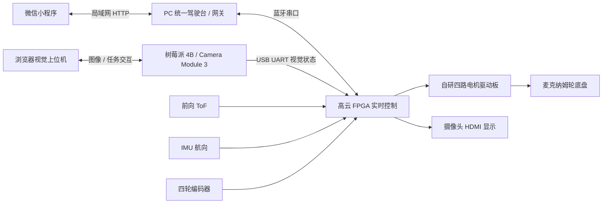
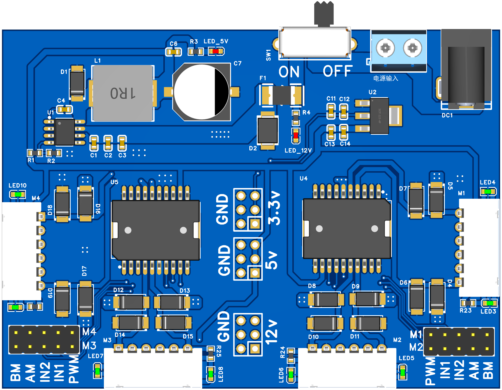

# 境觉行者具身智能自主移动机器人

**让数字视觉、距离感知、板内决策与四轮运动形成闭环。**

境觉行者是一套以国产高云 FPGA 为实时控制核心、树莓派为视觉计算节点的室内自主移动机器人。系统将数字靶标识别、ToF 测距、IMU 航向、编码器反馈、地图规划和四轮麦克纳姆运动连接起来，并通过 **PC 统一驾驶台、树莓派视觉网页和微信小程序**提供完整的人机交互。

本仓库保存 **R20 / K14** 最终 FPGA 工程、现场驾驶台、视觉服务、原生微信小程序、自研驱动板资料及配套测试。小程序已由项目作者完成实物机器人连接与控制验证。

> 工程目录中的 `SIN12`、`LingShu` 及部分早期文件名是内部研发标识。作品统一名称为“境觉行者具身智能自主移动机器人”；为保持模块接口和构建依赖，原代码名称继续保留。

## 系统亮点

- **异构协同**：树莓派承担图像处理，FPGA 并行采集传感器并执行控制，PC 与手机负责交互与任务配置。
- **感知到执行的闭环**：当前数字笔画确定视觉目标，ToF 提供距离，IMU 与编码器支撑转向、里程估计和运动反馈。
- **板内规划**：20×20 栅格、100mm 名义格距，FPGA 执行 BFS、逐格运动、动态测点投影与遇障重规划，保持原始终点。
- **统一交互**：驾驶台负责调试与诊断，网页负责图像观察和目标选择，小程序通过电脑中转提供移动操作。
- **明确的动作所有权**：运动仲裁、命令时效、停止入口、失联租约与传感器有效性共同约束执行。
- **完整工程交付**：RTL、约束、Gowin 工程、软件、模板、测试、历史验证摘要与硬件设计一并保存。

## 系统架构



视觉网页和手机不会绕过驾驶台与板端控制直接驱动电机。手机沿用原有蓝牙接线，树莓派继续通过独立 USB 串口向 FPGA 上报视觉信息。

## 六类演示任务

1. **手动驾驶与底盘控制**：前进、后退、横移、速度档位、四轮反馈及普通前进避障入口。
2. **航向与定角转向**：结合 IMU 执行定角旋转与直行航向修正。
3. **距离感知与前向避障**：接收 ToF 测距，识别近障，停车、局部处理与恢复受当前模式和许可约束。
4. **地图导航与动态重规划**：选择终点，由 FPGA 计算路线；遇到实际障碍后建图、检查占用并重新规划。
5. **数字确认后 ToF 跟随**：数字只触发一次，确认后跟随前方 ToF 物体，目标间距为 200mm；停止 S 取消。
6. **寻找指定数字、对准与接近**：准备数字与到达距离，通过任务身份与板端反馈完成搜索、接近、停稳和完成判定。

不同任务共享底层硬件，但目标跟随、到达型任务和地图导航保持各自的结束条件与状态语义。

## 核心模块

### FPGA 实时控制

主工程位于 [`fpga/sin12_hdmi/sin12_hdmi_system.gprj`](fpga/sin12_hdmi/sin12_hdmi_system.gprj)，顶层为 `sin12_hdmi_system.v`。目标器件为 **GW5AT-LV60PG484AC1/I0**，工程内部器件名为 GW5AT-60B。R20 的 UserCode 为 `0x534E3254`，能力标识 K14，地图 ID 为 `0x2613`。

控制侧以 50MHz 时钟为基础，形成 10ms 速度采样周期和 20kHz PWM；四轮编码器反馈用于轮速闭环，IMU 支撑航向修正和转向。命令所有者仲裁统一选择手动、导航、视觉和任务输出，停止与保护在执行出口生效。

主要阅读入口：

- [`fpga/motor_bt_drive`](fpga/motor_bt_drive)：任务状态机、运动仲裁、航向修正、跟随、停止与驾驶台。
- [`fpga/nav`](fpga/nav)：栅格地图、BFS、测点投影、逐格执行及动态重规划。
- [`fpga/sensors`](fpga/sensors)：IMU、ToF、有效性检查及状态上报。
- [`fpga/sin12_hdmi`](fpga/sin12_hdmi)：整机顶层、CST/SDC、视频与 HDMI 通路。

R20 依据连续距离进行测点投影，障碍物无需恰好位于格子中心。导航遇障触发距离采用 200mm 配置，并保留 210mm 安全膨胀与 100mm 硬停约束；路径逐格检查实际占用。`500` 编码器计数对应工程的名义 100mm 标定配置，部署到其他底盘时应按实物重新标定。

### 数字视觉与树莓派服务

当前默认使用 Printed Digit v4 模板识别通路，面向单个完整印刷数字 0–9。图像处理包含灰度与双阈值候选、相对亮背景、笔画归一化、有限角度校正和十类模板竞争。纸面边缘作为辅助几何信息，身份判定仍以当前画面中的完整数字笔画为依据。

关键代码为 [`src/detection/printed_digit.py`](src/detection/printed_digit.py)、[`src/detection/paper_digit_assist.py`](src/detection/paper_digit_assist.py) 与 [`assets/a4_digits_templates.json`](assets/a4_digits_templates.json)。配置保留 `0.86` 最低分和 `0.045` 类间差约束。YOLO 后端和原训练数据一并保留，只有显式切换后才使用对应模型。

树莓派服务入口为 [`src/web_gui.py`](src/web_gui.py)，网页位于 [`web/dashboard.html`](web/dashboard.html)，数字靶纸打印页为 [`web/a4-targets.html`](web/a4-targets.html)。服务提供相机图像、目标选择、锁定状态、任务准备、传感器反馈与串口诊断。

### PC 统一驾驶台

[`fpga/motor_bt_drive/pc_unified_console.py`](fpga/motor_bt_drive/pc_unified_console.py) 集中提供蓝牙连接、固件能力识别、手动操作、PID 调试、地图选点、当前位置确认、板内导航、数字触发跟随、智能任务与四轮遥测。

驾驶台区分参考路线、里程估计位置和新鲜障碍测点；通过固件版本、任务序号、原始终点和重规划代次核对状态。连接串口与授予运动许可是分开的操作，断开或停止后不会自动恢复旧动作。

### 微信小程序移动驾驶台

原生小程序工程位于 [`apps/wechat_console`](apps/wechat_console)，包含 WXML、WXSS、JavaScript 与电脑中转网关。**手机—电脑网关—原蓝牙串口—FPGA 的连接与控制已实机验证。**

- **驾驶**：距离、航向、按住式方向操作、速度档、90°转向、避障开关与四轮反馈。
- **地图**：20×20 栅格、停车确认位置、终点选择、ToF 偏移设置与板内导航。
- **视觉**：相机快照、数字选择、具体目标确认、智能任务准备与跟随操作。
- **连接**：电脑地址、每次运行的配对码、手机控制许可及维护入口。

小程序同时提供离线演示，方便不接设备时介绍功能。真实操作采用同一 Wi-Fi 下的电脑中转：手机控制租约为 400ms，前台每 100ms 续期；松手、后台、断线或本地停止会结束当前操作，重新进入前台需再次明确启用。详见 [小程序使用说明](apps/wechat_console/README.md)。

### 自研四路驱动板

驱动板集成四路电机输出、编码器接口、电源分配、降压、续流、输入保护与状态指示，使 FPGA 控制信号、电机功率回路和传感器供电形成可维护的硬件系统。相较直接套用小型 TB6612 模块，本项目重点改善多电机启动、换向时的功率回路布置、续流、供电与散热组织；可靠性取决于完整电路和实际负载匹配，不能仅以芯片名称判断。

原生 EDA 工程与原理图位于 [`hardware_design`](hardware_design)，使用原设计工具打开 `.epro2` 文件，SVG 可直接查看。



## 目录导览

```text
jingjue-xingzhe/
├─ fpga/                  # R20整机工程、RTL、约束与各阶段测试
├─ src/                   # 树莓派视觉、通信与任务服务
├─ web/                   # 视觉上位机网页与数字靶纸
├─ apps/wechat_console/   # 原生微信小程序与PC中转网关
├─ config/                # PC/Pi配置及标定参数
├─ assets/                # 数字模板库
├─ tests/                 # Python协议、导航、视觉与界面测试
├─ scripts/               # 部署、离线检查与构建入口
├─ hardware_design/       # 驱动板EDA工程及原理图
├─ data/                  # 原工程实验图像、标注与训练数据
├─ models/                # 可选YOLO后端模型资料
├─ firmware_reference/    # 对应版本参考位流
├─ verification/          # 原始验证摘要
├─ reproducibility/       # 冻结清单、原构建输入与映射验证源
└─ docs/                  # 补充资料与页面图片
```

最终整机编译依赖以主 GPRJ 的文件清单为准。目录中的早期 bring-up 工程、R12–R19 回归与历史说明保留用于追溯，不作为当前启动入口。

## 快速开始

### 1. 获取工程

```bash
git clone https://github.com/cxy-299/jingjue-xingzhe.git
cd jingjue-xingzhe
```

PC 使用 Python 3.10 或 3.11（含 Tkinter）；Node.js 用于运行小程序 JavaScript 离线测试。硬件综合需要本机安装 Gowin FPGA Designer，RTL 仿真使用 Questa/ModelSim 及本机厂商原语库。

### 2. PC 驾驶台

```powershell
py -3.10 -m venv .venv
.\.venv\Scripts\python.exe -m pip install -r requirements-console.txt
.\start_console.cmd
```

入口默认不自动连接蓝牙；在界面选择实际 COM 口，并按本次使用状态核对固件和运动许可。

### 3. 微信小程序与电脑网关

在项目根目录运行：

```powershell
.\.venv\Scripts\python.exe -m pip install -r apps/wechat_console/requirements-gateway.txt
.\.venv\Scripts\python.exe apps/wechat_console/start_pc_gateway.py --port COM9 --pi-base http://192.168.137.129:8080
```

COM9 和树莓派地址为示例，使用现场实际值。网关会打开配套驾驶台并显示电脑地址与本次配对码；它复用同一串口所有者。电脑完成本地确认后允许手机控制，手机在“连接”页关闭离线演示、填写网关地址和配对码，再启用本次控制。

微信开发者工具导入 `apps/wechat_console`，小程序根目录已配置为 `miniprogram/`。源码分享配置保留通用 `touristappid` 占位，使用自己的 AppID 和本机私有配置；不要提交账号凭据。手机和电脑处于同一受信任局域网，电脑网关不直接开放至公网。

无需硬件时，可先在开发工具体验默认离线演示，或打开 `apps/wechat_console/qa/preview.html` 查看浏览器布局预览；浏览器预览与原生微信运行时属于不同入口。

### 4. 树莓派视觉网页

使用 Raspberry Pi OS、树莓派 4B 和 Camera Module 3。Picamera2 与 OpenCV 通过系统软件包准备，按 [`README_PI_DEPLOY.md`](README_PI_DEPLOY.md) 和 [`README_PI_TASK56_MAINTENANCE_CN.md`](README_PI_TASK56_MAINTENANCE_CN.md) 配置环境后运行：

```bash
python3 -m src.web_gui --config config/config-pi.yaml --host 0.0.0.0 --port 8080
```

浏览器访问 `http://树莓派实际IP:8080`。当前默认数字模板后端不依赖 YOLO 权重；`requirements-pi.txt` 保留可选 YOLO 环境的固定版本配置，使用前区分识别后端。

### 5. FPGA 工程构建

在 Gowin IDE 中打开 `fpga/sin12_hdmi/sin12_hdmi_system.gprj`，或使用相对路径构建入口：

```powershell
powershell -ExecutionPolicy Bypass -File scripts/build_submission_fpga.ps1 -GowinShell "本机Gowin安装目录/IDE/bin/gw_sh.exe"
```

该入口只综合和布局布线，不自动下载。参考工具版本为 Gowin V1.9.12.04。主工程及两个 Tcl 已作路径可移植整理，RTL 与时序约束保持冻结版本字节一致；原始构建输入在 `reproducibility/original_build_inputs` 中保存。

## 离线验证与结果记录

```powershell
python -m pip install -r requirements-dev.txt
python scripts/check_submission_sources.py
python -m pytest tests/test_protocol.py tests/test_r20_contracts.py tests/test_r20_console_map.py -q
python -m pytest apps/wechat_console/tests/test_gateway.py apps/wechat_console/tests/test_vision_proxy.py -q
node apps/wechat_console/tests/client.test.js
```

这些入口使用文件、协议、模拟后端与回环网络，不连接现场蓝牙或启动机器人。完整 Tk 集成回归与 RTL 仿真分别见小程序验证说明、`tests/`、`fpga/` 中的测试入口。

`verification/original_results` 保存原 R20 验证摘要：setup/hold 违规数均为 0，六时钟与约束检查通过，报告最小 setup 裕量为 **+1.521ns**、hold 为 **+0.042ns**。ToF、视觉目标与导航分别保存对应综合网表的映射验证报告。报告属于已归档实现的结果；重新综合后应检查本轮实际产物，不以旧报告替代新构建验收。

本次上传保留可复核的冻结清单、原验证报告和软件测试源。`PACKAGE_SHA256.json` 对应本仓库初次上传快照；修改文件后应显式更新清单。原比赛提交包的校验清单位于 `reproducibility/submission_package_sha256.json`，用于区分两个交付快照。

## 工程说明

- 当前 R20 板内导航采用实际距离投影与动态占用检查；小车几何、探头安装偏移和编码器尺度应与实际平台一致。
- 参考蓝线、估计位置、视觉检测与真实传感器状态分别表达不同信息，任务是否执行及结束以当前板端回传为依据。
- 运行软件、打开网页与源码校验都不会自动授予运动许可；固件下载和现场运动使用独立入口。
- 仓库不包含 Python 虚拟环境、已安装第三方库、全部历史构建目录、运行日志、录像或开发工具安装包。
- 项目源文件与第三方参考代码保留原版权标识；详见 [`THIRD_PARTY_NOTICES.md`](THIRD_PARTY_NOTICES.md)。本仓库不额外套用一份覆盖所有组件的统一许可证。

## 进一步阅读

- [微信小程序说明](apps/wechat_console/README.md) · [网关架构](apps/wechat_console/docs/ARCHITECTURE.md) · [小程序验证记录](apps/wechat_console/docs/VALIDATION.md)
- [树莓派部署](README_PI_DEPLOY.md) · [任务5/6维护](README_PI_TASK56_MAINTENANCE_CN.md)
- [视觉与ToF协同](README_VISION_TOF.md) · [GUI导航入口](README_GUI_NAV_GOAL_CN.md)
- [历史工程说明](docs/historical_README.md)

**境觉行者：感知环境、理解目标、闭环行动。**
