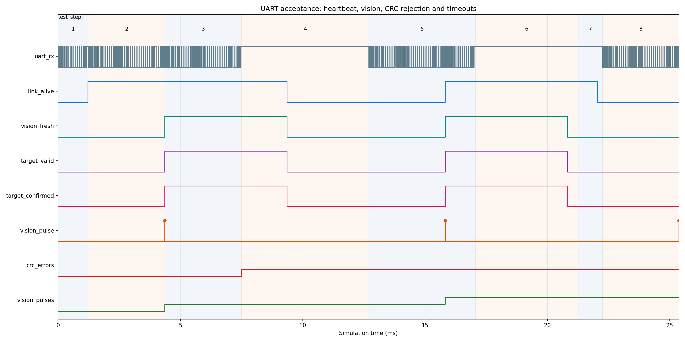
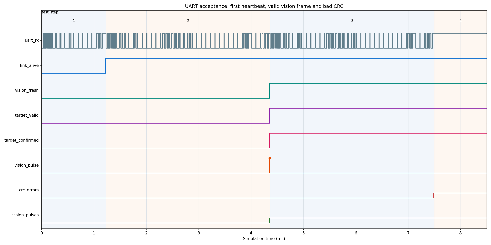

# 树莓派 → ACG720 UART 通信仿真验收报告

日期：2026-10-13。范围：Python 协议打包、串口发送端、FPGA UART 接收/CRC/超时逻辑、GUI 发送诊断。**本次修改只在电脑仓库内；尚未部署到树莓派，也未进行 FPGA 下载、树莓派实机写串口或电机联调。**

## 1. 接线与协议基线

- 计划接线：树莓派 USB-A → ACG720 板载 CH340E UART Type-C；两板各自供电。USB 串口不是 JTAG 下载线。
- 串口：115200 baud、8-N-1、单向 Pi→FPGA。仓库中的 Pi 配置为 `auto_usb_ch340`，只在发现唯一 CH340 时自动打开；多个设备需配置准确的 `/dev/serial/by-id/...`。实机树莓派上的旧配置需在下板联调阶段同步。
- 帧格式：`AA 55 | 03 | type | seq(u16 LE) | len(u16 LE) | payload | CRC16-CCITT(u16 LE)`。心跳类型 `01`、视觉类型 `13`。CRC 只覆盖版本到载荷。
- FPGA 板级验收顶层仅输出 LED2–LED7，不连接电机。默认链路/视觉超时均为 1500 ms；testbench 缩为 5 ms 加速仿真。

## 2. 本次结果

| 项目 | 结果 | 证据 |
| --- | --- | --- |
| Python 自动测试 | 23 项通过 | `python -m pytest -q tests`；含 CH340 自动选择、多个设备拒绝、Python 向量一致性 |
| UART RTL 自检 | PASS | [XSIM 日志](fpga/acg720_uart_bringup/uart_verify_xsim.log)：UART、CRC、字段、心跳、双超时、无目标 |
| Python 原始字节→RTL | PASS | [跨语言日志](fpga/acg720_uart_bringup/python_vector_xsim.log)：心跳、有效瓶子、无目标三帧 |
| ModelSim 本次运行 | 未执行成功 | 程序启动但提示 `Invalid license environment`，未签出许可证；不能把 XSIM 结果记作 ModelSim PASS |
| 板上实际接收 | 未验证 | 本阶段没有下载位流或连接树莓派实机发送；GUI 单向串口无 FPGA 回执 |

跨语言向量由 `src.comm.protocol` 真正生成，`tests/test_protocol_vectors.py` 会检查 [字节文件](fpga/acg720_uart_bringup/python_uart_frames.mem) 与当前 Python 代码完全一致。FPGA 测试平台按 115200 8-N-1 串行发送这些字节，而不是直接给解析器喂字段。

## 3. 波形图与判读

以下 PNG **不是 ModelSim 窗口截图**；它们是本次 XSIM 实际导出的 [VCD 原始波形](fpga/acg720_uart_bringup/uart_verify_xsim.vcd) 经 [绘图脚本](fpga/acg720_uart_bringup/plot_uart_vcd.py) 渲染的波形截图。时间单位为 ms；上方数字是 testbench 的 `test_step`。高电平画在每行上侧。

| 仿真时刻 | 观察 | 判定 |
| --- | --- | --- |
| 1.220 ms | 正确心跳使 `link_alive` 升高；`vision_fresh` 仍为 0 | 心跳不会伪造视觉结果 |
| 4.353 ms | 正确视觉包使 `vision_fresh/target_valid/target_confirmed` 升高，`vision_pulses` 加至 1 | 收包与字段发布成功 |
| 7.487 ms | 故意损坏 CRC 后 `crc_errors` 变为 1，`vision_pulses` 不变 | 坏帧被丢弃 |
| 9.353 ms | 视觉与链路超时均清零，目标失效 | 断流安全门控有效 |
| 15.820 ms | 第二个正确视觉包使目标恢复 | 恢复收包有效 |
| 20.820 ms | 仅心跳续命后 `vision_fresh/target_valid` 归零，链路仍活着 | 陈旧视觉目标不能继续控制 |
| 22.044 ms | 心跳也超时，`link_alive` 归零 | 失联检测有效 |
| 25.378 ms | 无目标视觉包使 `vision_pulses` 加至 3，但 `target_valid` 保持 0 | 明确丢失目标安全处理有效 |

跨语言测试还检查 `class_id=39`、`confidence=9000`、`center_x=3000`、`center_error=-4000`、`area_ratio=648`、`frame_id=77/78`、`sequence=11/12` 与零 CRC 错误；因此 Python 小端编码、符号位和 RTL 字段映射一致。

## 4. GUI 与安全边界

[监控界面](web/dashboard.html)新增实际 USB 端口、已发送帧/字节数、最近类型/序号/发送时间、视觉目标状态和串口错误。文字明确标注“**仅本地写入成功，接收端未确认**”，防止把串口打开误判为 FPGA 已收到。断线会自动重连；多个 CH340 时不自动选择，避免发送到错误设备。

Pi 目标类别由旧配置的 `person` 改成 COCO `bottle`。这只识别一般瓶子，**尚未验证红色水瓶筛选**。树莓派仍只发视觉结果，不发送 PWM/速度；导航、ToF、安全停机和轮控仍由 FPGA 承担。

## 5. 下板前后验收门槛

1. ModelSim 许可证恢复后，可在 `fpga/acg720_uart_bringup` 执行 `do run_modelsim.do`；本次已有 XSIM 的两项独立 PASS，但不能替代所需的 ModelSim 实测记录。
2. 先确认树莓派上只有一块 CH340：`python -m serial.tools.list_ports -v`。若出现多块，填准确 `/dev/serial/by-id/...`，并确认运行中的 GUI 与测试脚本不同时占用串口。
3. 下板阶段先下载无电机输出的 UART 验收顶层，再用 `python -m scripts.serial_fpga_test --count 10` 发左右交替帧；看 FPGA LED3–LED6，且 LED7 不应因正常包亮起。停止发送 1.5 s 后链路/目标灯应灭。
4. 只有实体 LED/接收状态与上述预期一致，才继续接入完整机器人顶层；届时仍须单独验收红色筛选、ToF、导航和电机接口。

本次没有重启电脑、没有写 FPGA SRAM/Flash，也没有操作电机。
